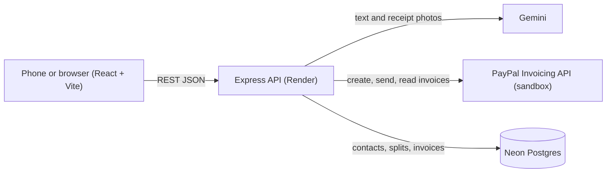

Claude

Readme · MD

# SplitPay AI

**Split bills with AI. Get paid with PayPal.**

SplitPay AI turns a plain-language message (or a receipt photo) into a fair split, sends each friend a real PayPal invoice, and tracks who has paid. Friends who have not paid get a one-tap WhatsApp or SMS reminder with their PayPal link already in the message.

Built for the **PayPal AI Hackathon** on Devpost. Everything runs in the **PayPal sandbox** with test money.

|             |                                  |
| ----------- | -------------------------------- |
| Live demo   |https://splitpay-ai-app.onrender.com/
| Demo video  | [YOUTUBE LINK]                   |
| Backend API | https://splitpay-ai.onrender.com |
| Devpost     | [DEVPOST LINK]                   |

> **Note for testers:** the free servers sleep when idle, so the first request can take up to a minute. Open the backend URL once to wake it. Test login details for the PayPal sandbox are in the Devpost "testing instructions", not in this repository.

## The problem

Splitting a bill is easy. Collecting the money is not. People chase friends on chat apps, argue about who owes what, and lose track of who has paid.

## What it does

- **Describe it (AI):** type "Dinner was $120, Rahul had drinks so he owes more". Gemini returns a fair split. The server re-checks the math in cents, so the amounts always add up exactly.
- **Manual split:** pick people and type an amount for each.
- **Receipt scan:** upload a bill photo. AI reads the items, tax and tip. You tap who had which item, and tax and tip are shared in proportion.
- **Review before sending:** nothing is sent until you confirm.
- **Real PayPal invoices:** one invoice per friend, created and sent through the PayPal Invoicing API.
- **Payment tracking:** the Status tab asks PayPal for the latest status and shows Paid or Waiting.
- **WhatsApp and SMS reminders:** a ready-made message with each person's PayPal pay link. The app opens WhatsApp or SMS with the text filled in, and you tap Send.
- **Saved contacts and history:** stored in Postgres, so data survives restarts.
- **Mobile-first UI:** installable look, avatars, settings screen, accessible tap targets.

## How it works



1. The user picks friends and describes the expense, types amounts, or scans a receipt.
2. The API returns a **preview** (no money moves yet).
3. The user confirms. The API saves the split, then creates and sends a PayPal invoice for each friend who owes money.
4. The API stores each invoice and its pay link. The Status tab refreshes payment status from PayPal.
5. For anyone still unpaid, the app builds a WhatsApp or SMS link with the pay link inside.

## How PayPal and AI are used

**PayPal (central to the app)**

- OAuth 2.0 client-credentials token for the sandbox.
- Invoicing API v2: create an invoice, send it to the recipient, read it back for its status (SENT or PAID) and its payer link.
- The invoice is the payment request. Friends pay it with their PayPal account.
  **AI (Gemini)**
- Understands a free-text expense and returns a structured split as JSON.
- Reads receipt photos (vision) and returns merchant, items, tax, tip and total.
- Guardrails: the server verifies all amounts in cents and fixes rounding, a human reviews every split before sending, and the model call retries and falls back across several Gemini models when one is busy.

## Tech stack

| Layer    | Tools                                                     |
| -------- | --------------------------------------------------------- |
| Frontend | React, Vite, plain CSS design tokens                      |
| Backend  | Node.js 18+, Express, ES modules                          |
| Payments | PayPal Invoicing API (sandbox)                            |
| AI       | Google Gemini via `@google/genai`                         |
| Database | Neon Postgres via `pg`                                    |
| Hosting  | Render (web service for the API, static site for the app) |

## Project structure

```
backend/
  src/server.js    routes and flow
  src/paypal.js    PayPal token, invoices, status, pay link
  src/ai.js        Gemini: expense parsing, receipt scan, model fallback, math check
  src/split.js     split by items with proportional tax and tip
  src/db.js        Postgres connection
  src/test-*.js    small scripts to try each part from the terminal
frontend/
  src/             screens and components (Split, Contacts, Status, Settings)
  src/api.js       every backend call lives here
```

## API

All requests and responses are JSON. Splits return a **preview** and send nothing.

| Method and path            | Purpose                                          |
| -------------------------- | ------------------------------------------------ |
| `GET /api/contacts`        | List contacts                                    |
| `POST /api/contacts`       | Add a contact `{name, email, phone}`             |
| `DELETE /api/contacts/:id` | Delete a contact                                 |
| `POST /api/split`          | AI split from text `{message, people}`           |
| `POST /api/split/manual`   | Preview from typed amounts                       |
| `POST /api/receipt/scan`   | Read a receipt photo `{imageBase64, mimeType}`   |
| `POST /api/split/items`    | Preview from receipt items and who had what      |
| `POST /api/send`           | Confirm: save the split and send PayPal invoices |
| `GET /api/invoices`        | Invoices with live status and reminder links     |

## Run it locally

**Requirements:** Node.js 18 or newer, a free Neon database, a free Gemini API key, and a PayPal developer account.

### 1. PayPal sandbox

1. In the PayPal Developer Dashboard (Sandbox), open Testing Tools, then Sandbox Accounts. Create one **Business** and one **Personal** account, both with country **United States**. Indian sandbox accounts cannot send invoices.
2. Create an app (type Merchant) linked to the US Business account. Enable **Invoicing** under Features and save.
3. Copy the app's Client ID and Secret.

### 2. Database

Create a Neon project and run this in its SQL Editor:

```sql
create table contacts (
  id uuid primary key default gen_random_uuid(),
  name text not null, email text not null, phone text,
  created_at timestamptz default now());
create table splits (
  id uuid primary key default gen_random_uuid(),
  description text not null, total numeric(10,2), paid_by text,
  created_at timestamptz default now());
create table invoices (
  id uuid primary key default gen_random_uuid(),
  split_id uuid references splits(id) on delete cascade,
  name text not null, email text, phone text,
  amount numeric(10,2) not null,
  paypal_invoice_id text not null, pay_url text,
  status text default 'SENT',
  created_at timestamptz default now());
```

### 3. Backend

```bash
git clone https://github.com/SanketMohite01/splitpay-ai.git
cd splitpay-ai/backend
npm install
cp .env.example .env     # then fill in the four values
npm start                # http://localhost:3001
```

| Variable               | What it is             |
| ---------------------- | ---------------------- |
| `PAYPAL_CLIENT_ID`     | Sandbox app Client ID  |
| `PAYPAL_CLIENT_SECRET` | Sandbox app Secret     |
| `GEMINI_API_KEY`       | Google AI Studio key   |
| `DATABASE_URL`         | Neon connection string |

Secrets live only in `backend/.env` (ignored by Git) and in the host's environment settings. The frontend never holds a secret.

### 4. Frontend

```bash
cd ../frontend
npm install
npm run dev -- --host
```

By default the app talks to the hosted API. To use your local API, create `frontend/.env.local` containing `VITE_API_URL=http://localhost:3001`.

## Try it (about 3 minutes)

1. Open the app, go to **Contacts**, and add a friend using the **Personal** sandbox email and a fake phone number.
2. On **Split**, pick the friend, type an expense, and tap **Split with AI**. Review the preview, then confirm.
3. Open the invoice link from the Sent screen in a **private window** and log in as the sandbox **Personal** account. You cannot pay with the Business account, because PayPal blocks paying the merchant that issued the invoice.
4. Pay the invoice (test money), then open the **Status** tab and tap **Refresh**. It shows **Paid**.

## Limitations and next steps

- Sandbox only. No real money moves. Amounts are in USD.
- No user accounts yet. All visitors share one set of contacts and invoices, so please use test names and emails only. Next step: sign-in with per-user data.
- Free hosting sleeps when idle, and the free Gemini tier can be busy. The API retries and falls back across models.
- WhatsApp and SMS open a pre-filled message. The user taps Send, so nothing is sent automatically.
- Planned: edit contacts, recurring splits, more currencies, payment reminders on a schedule.

## Team

- **Sanket Mohite** ([@SanketMohite01](https://github.com/SanketMohite01)): backend, PayPal and AI integration, database, deployment
- **Tejasvii** ([@Tejasvii09](https://github.com/Tejasvii09)): frontend

## License

MIT. See [LICENSE](LICENSE).
